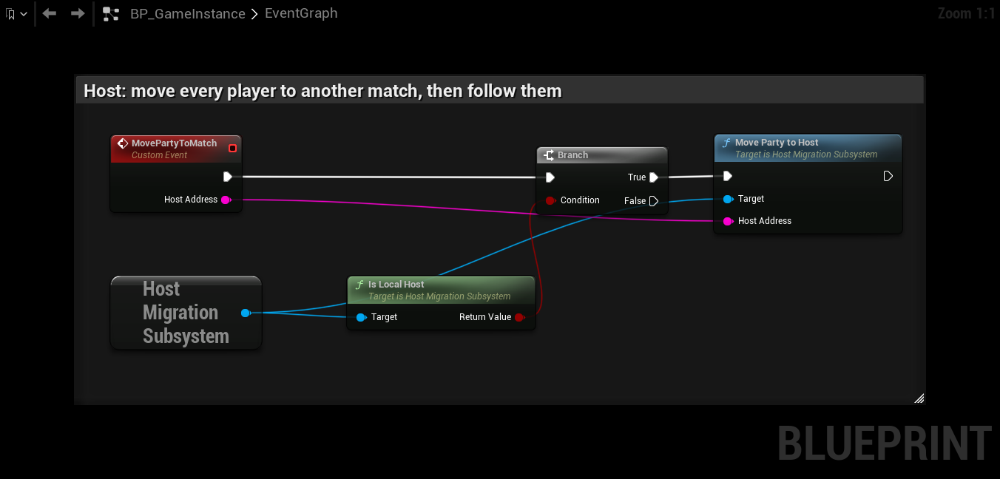
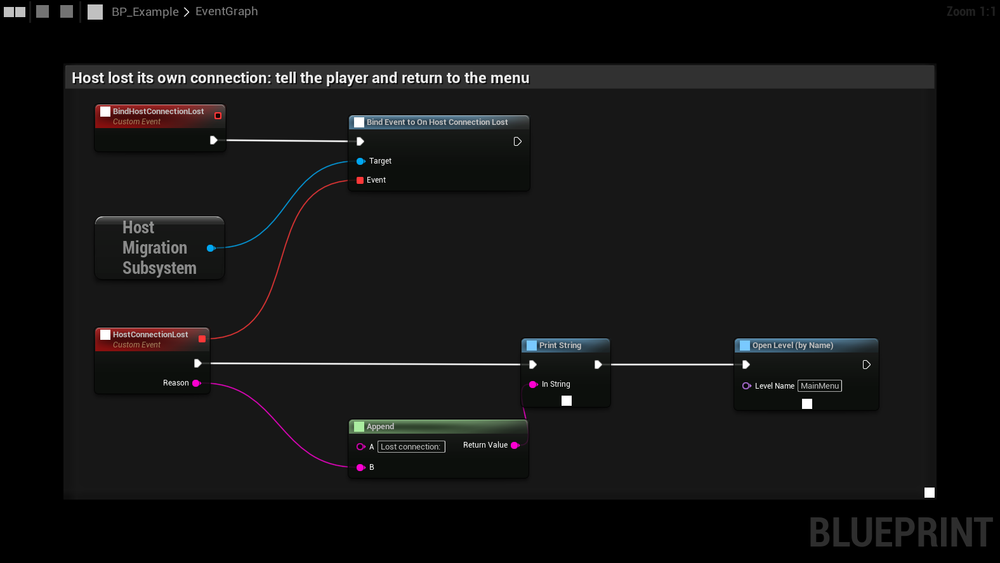

## Added

- The debug overlay displays the player's role, migration state, epoch, current host, successor list, snapshots, and lobby.
- Move Party To Host sends the connected clients to another host before moving the current host.

- Added On Host Connection Lost.

## Changed

- When the plugin finds multiple hosts, it prefers the one with the newest epoch and uses player count as a tiebreaker.
- Switching lobbies mid-match is treated as leaving the match.
- Steam and EOS automatically rejoin the match lobby if a player loses membership during play.
