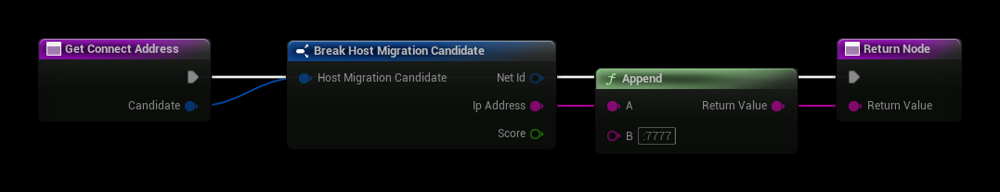
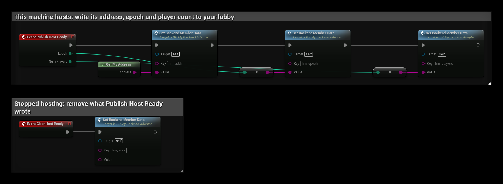

# Blueprint Adapter

Connect host migration to any backend you already use (Advanced Sessions, your own lobby service, a web API) without
C++.

1. Create a Blueprint class with parent **Host Migration Adapter (Blueprint)**.
2. Pick it in **Project Settings → Plugins → Host Migration → Adapter Class**.
3. Override only what your backend can do.

## Events to override

| Event | Needed for |
|---|---|
| **Get Connect Address** (Candidate) | Minimum. The address to reach a candidate once it hosts. Default: the IP the old host saw, plus **Listen Port**. |
| **Get Local Host Address** | The address others use to reach this machine while it hosts. |
| **Publish Host Ready** (Epoch, Num Players) | Announcements. Write this machine's address, epoch and player count to your lobby. |
| **Clear Host Ready** | Announcements. Remove what Publish Host Ready wrote. |
| **Get Announced Hosts** (out Hosts) | Announcements. Return every announced host and **true**. |
| **Get Member Presence** (Player Id) | Rejoin. Present, Gone or Unknown. |
| **Score Candidate** (Player State) | Optional. Ranks successors, lower is better. Default: ping. |

The plugin calls these events. You cannot call them from your own graph, so put anything you need in more than one
place, such as this machine's address, in a function of your own.

**Get Connect Address** with a fixed port:

**Publish Host Ready** and **Clear Host Ready** writing to a lobby service. `Set Backend Member Data` and
`Get My Address` stand for your backend's own calls:

**Get Announced Hosts** reads them back as one **Host Migration Announcement** per host:

| Field | What to fill in |
|---|---|
| **Host Key** | Something unique per host, for example the player id. |
| **Address** | What this host wrote as its address. |
| **Epoch** | What this host wrote as its epoch. |
| **Num Players** | What this host wrote as its player count. |

**Get Connect Address** gets a **Host Migration Candidate**: **Net Id** (the player's unique net id), **Ip Address**
(the IP the old host saw) and **Score**.

## Levels of support

- **Only Get Connect Address:** like the Null adapter. Clients assume the successor is up after **Assumed Host Delay**.
- **Plus announcements:** waiting clients join the first host that announces, and two hosts at once are detected
  and resolved.
- **Plus presence:** a player whose connection drops while the host is still there rejoins the host instead of
  migrating.

## Calls

| Node | What it does |
|---|---|
| **Announce Host** (Host Id, Address, Epoch) | If your backend pushes events, call this when a host announcement arrives. |
| **Refresh Host Announcement** | Your backend became usable after hosting started (e.g. the lobby was joined late). Publishes again. |
| **Get Migration Subsystem** | The subsystem this adapter works for. |

The adapter has a world, so world-context nodes work inside it.
