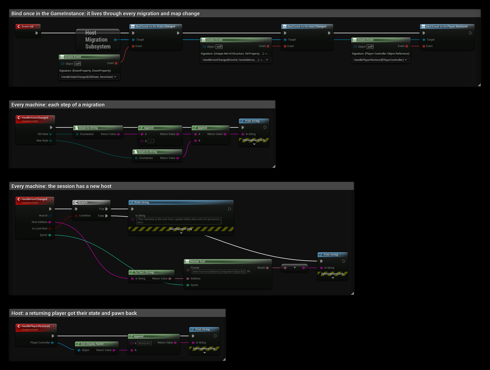

# Blueprint Overview

Everything you need for host migration works without C++.

## State

Tick **SaveGame** on Blueprint variables (variable details → Advanced → **SaveGame**). They travel like
`UPROPERTY(SaveGame)` in C++, on actors and components alike, including object references to other migrated actors.

Add the **Host Migration Id** component to every actor that should survive.

## Subsystem

Get it with **Get HostMigrationSubsystem** (it's a GameInstance subsystem).

| Node | What it does |
|---|---|
| **Leave Session** | Leave the match. On the host, hands it over first. |
| **Quit Game** | Quit the game. On the host, hands it over first. Use instead of the engine's Quit Game. |
| **Begin Graceful Migration** | Host: send a final snapshot and tell everyone to migrate now. |
| **Get State** | Current [state](#states). |
| **Is Migrating** | True during a migration (not Running, not Failed). |
| **Is Local Host** | True on the machine that hosts. |
| **Get Epoch** | Increases with each migration. |
| **Get Status Text** | Localized status line for UI. |
| **Get Num Players Awaited** | Players the new host is still waiting for. |
| **Get Host Address** | Address of the current host. |
| **Find Host In Lobby** (out Host Address, Epoch) | For players not connected yet: where the current host is. Pure node, returns false if no host has announced itself. |
| **Get Num Inactive Players** | Host: players whose state is kept for a rejoin. |
| **Get Snapshot Stats** | Host: snapshot sizes and traffic. |

## Subsystem events

| Event | When |
|---|---|
| **On State Changed** (Old State, New State) | Every state change, on every machine. |
| **On Player Restored** (Player Controller) | Host: a returning player got their state back. |
| **On Host Changed** (Host Id, Host Address, Is Local Host, Epoch) | The session has a new host. Use it to update lobby data or rich presence. |

Bind them in your **GameInstance** (Event Init). A migration loads the map again, which destroys actors and widgets
together with the events bound in them.

## Library nodes

| Node | What it does |
|---|---|
| **Get Migration Id** | The id that identifies an actor across migrations. |
| **Find Actor By Migration Id** | The actor that carries an id now. |
| **Is Host Migration In Progress** | Same as Is Migrating, from any world context. |
| **Is Migration Host** | True on the machine that hosts. |
| **Unique Net Id To String** | The string form used for player ids. |

## Steam

**Get Steam Lobby** returns the lobby in use, or an empty string if there is none or the Steam adapter is not active.
**Set Steam Lobby** overrides the detected lobby. Both work from any Blueprint. See [Steam](../features/steam).

## EOS

**Get EOS Lobby** returns the lobby in use, or an empty string if there is none or the EOS adapter is not active.
**Set EOS Lobby** overrides the detected lobby. Both work from any Blueprint. See [EOS](../features/eos).

## States

`EHostMigrationState`, returned by **Get State** and passed to **On State Changed**.

| State | Meaning |
|---|---|
| `Running` | Normal play. |
| `Electing` | The host was lost; picking a successor. |
| `BecomingHost` | This machine is the successor and is loading the map. |
| `WaitingForHost` | Waiting for the successor to announce itself. |
| `Reconnecting` | Connecting to the new host. |
| `GracePeriod` | New host: waiting for previous players. |
| `RejoiningHost` | Connection dropped but the host is still in the session; reconnecting to it. |
| `Failed` | The migration did not succeed. |
