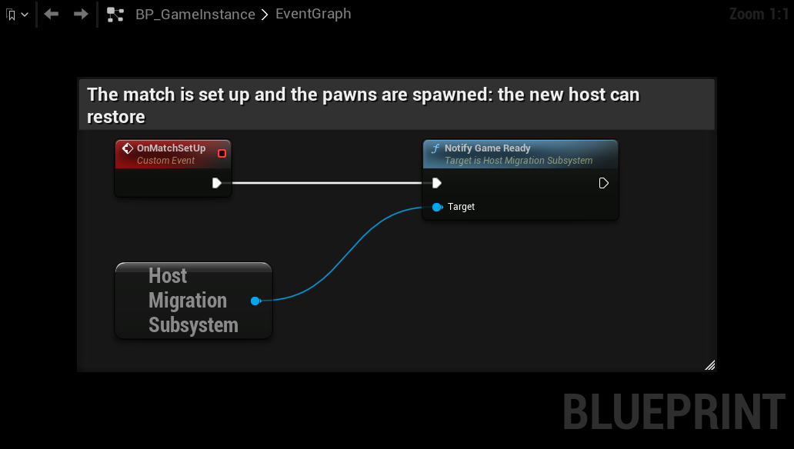
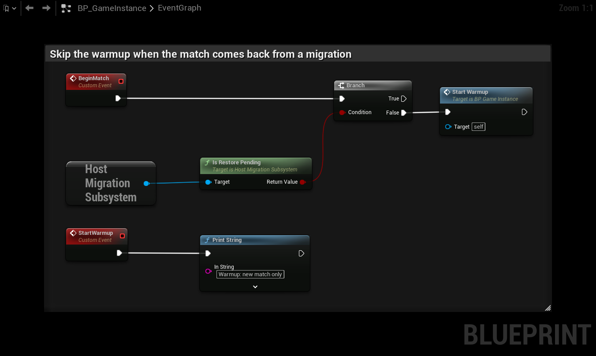

# Games that set up the match later

By default the new host restores the saved state as soon as the map has loaded its actors. Some games set up the match
after that: they load game mode data, game features or components asynchronously, and only then spawn pawns and add
the components that hold the score. Lyra's experiences are an example. Restoring before that is too early: the state
lands on objects that are not there yet, and the game then starts the match from scratch.

## Wait For Game Ready

Turn on **Wait For Game Ready** and call **Notify Game Ready** on the subsystem when your game has set up the match.

1. The new host loads the map and waits. The overlay keeps showing, and the host is not announced yet.
2. Your game sets up the match as usual, including spawning the players' pawns.
3. You call **Notify Game Ready**. The plugin restores the actors, GameMode, GameState and players, announces the host
   and starts the grace period.



If **Notify Game Ready** is not called within **Game Ready Timeout** (default 30 s), the plugin restores anyway.

```ini
[/Script/HostMigrationCore.HostMigrationSettings]
bWaitForGameReady=true
GameReadyTimeout=30.0
```

Call **Notify Game Ready** on every match start, not only after a migration. Outside a migration it does nothing.

## Pawns the game spawned

When the game has already spawned a pawn for a player and that player's saved pawn is of the same class, the plugin
uses the game's pawn: it moves it to the saved position and loads the saved state into it. Everything the game set up on
the pawn stays. If the classes differ, the saved pawn is spawned and possessed, and the game's pawn is destroyed.

## Returning players

A player who comes back later (after a migration, or after stepping away) logs in before the game has spawned a pawn
for them. By default the plugin gives them their saved pawn right away. For games that set up their pawns themselves,
turn on **Restore Into Game Pawn**: the plugin waits for the pawn the game spawns for the player, moves it to the saved
position and loads the saved pawn's state into it. The saved pawn is removed. If the classes differ, the game's pawn is
kept and the saved one stays in the world.

```ini
[/Script/HostMigrationCore.HostMigrationSettings]
bWaitForGameReady=true
bRestoreIntoGamePawn=true
```

## Is Restore Pending

**Is Restore Pending** is true on the new host from the map load until the restore. Use it to skip things that should
only happen in a new match, such as a warmup phase or a match timer reset.



## Example: Lyra

Lyra loads its experience after the map, so the new host has to wait for it.

:::tip Video
The [Lyra setup video](../videos/lyra-setup) shows these steps.
:::

1. Turn on **Wait For Game Ready** and **Restore Into Game Pawn** in `Config/DefaultGame.ini`:

```ini
[/Script/HostMigrationCore.HostMigrationSettings]
bWaitForGameReady=true
bRestoreIntoGamePawn=true
```

2. Add `HostMigrationCore` to the dependencies in `Source/LyraGame/LyraGame.Build.cs`:

```csharp
PrivateDependencyModuleNames.AddRange(
	new string[] {
		"HostMigrationCore",
		"InputCore",
```

3. In `Source/LyraGame/GameModes/LyraGameMode.cpp`, include the subsystem:

```cpp
#include "HostMigrationSubsystem.h"
```

4. In `ALyraGameMode::InitGameState`, call **Notify Game Ready** once the experience has loaded. Register it with low
   priority, after the existing `CallOrRegister_OnExperienceLoaded` line, so the game mode has spawned the pawns first:

```cpp
ExperienceComponent->CallOrRegister_OnExperienceLoaded_LowPriority(FOnLyraExperienceLoaded::FDelegate::CreateWeakLambda(this, [this](const ULyraExperienceDefinition*)
{
	if (UHostMigrationSubsystem* Migration = GetGameInstance() ? GetGameInstance()->GetSubsystem<UHostMigrationSubsystem>() : nullptr)
	{
		Migration->NotifyGameReady();
	}
}));
```

5. Build the project.

Lyra's CommonSessionSubsystem also joins sessions through a reservation beacon on the host. The new host has no
beacon, so players who come back or join late cannot join it. Turn the beacons off in `Config/DefaultEngine.ini`, and
in any platform config that sets them again (for example `Config/Custom/Steam/DefaultEngine.ini`):

```ini
[/Script/CommonUser.CommonSessionSubsystem]
bUseBeacons=false
```

Lyra keeps its match state (scores, stats, teams, the match timer) in properties without SaveGame. See
[Tutorial: Lyra Sample Project](../tutorials/lyra-match) for how to carry it over with Blueprint.
