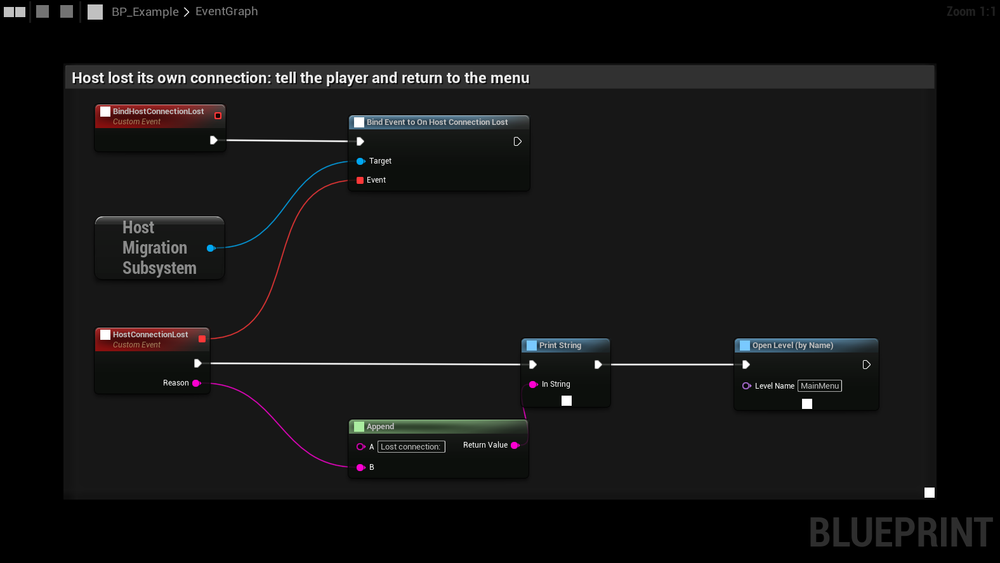

# Lost connection: rejoin, reconnect, split brain

A dropped connection does not always mean the host is gone. These rules keep one player's network trouble from
splitting the match. They need an adapter with presence and announcements (Steam and EOS do both).

## Is the host gone, or only us?

When the connection drops, the client asks the adapter whether the host is still in the session (Steam and EOS:
lobby membership).

- **The host is still there:** the client **rejoins the host** (state `RejoiningHost`) for up to **Rejoin Timeout**
  and gets its state back as a returning player. No migration, so a player with a hiccup never splits off into a match
  of their own.
- **The host leaves the session meanwhile:** the client migrates after all.
- **The host is still listed but has stopped running:** every host updates a heartbeat in the lobby every
  **Heartbeat Interval** (default 5 s). If it has not changed for **Heartbeat Timeout** (default 15 s), the client
  migrates without waiting for the lobby to drop the crashed host. Keep the timeout at least three times the interval.
  This check is skipped when the client could not follow the host to a new map, because a host that is loading a map
  does not update its heartbeat.
- **The host stays but cannot be reached:** the client gives up (**Migrate When Host Unreachable** off, the default)
  or migrates anyway (on). Even with it on, a client does not migrate while the host's announcement shows that it
  still has other players: then only this client lost the host, and it leaves instead of starting a match of its own.
- **The host kicked the player:** the client does neither. See
  [Kicked players](players-coming-back#kicked-players).

## Where clients wait

While a client waits for the host or a new host, the engine's disconnect travel (`?closed`, normally to the main menu)
is held back. The client stays in the match world with the connection closed, or loads **Client Wait Map** if you set
one. The same applies for 1.5 seconds after a host closes the connection, while the client finds out whether the
match has ended or is being handed over.

## Connecting to the new host

Clients reconnect with the URL options they joined the match with (**Keep Client Join Options**, on by default):
`?Name=`, a password, or your own login options. **Reconnect URL Options** (for example `?Team=2`) is added to them.
Call **Set Reconnect URL Options** on the subsystem to change it at runtime. When the same key appears twice, the later
one wins.

Connections are retried **Max Reconnect Attempts** times, **Reconnect Retry Delay** apart. An attempt that has not
connected within **Connect Attempt Timeout** (30 s, 0 = no limit) is cancelled and counts as failed. If that host stays
unreachable, the client moves on to the next candidate. A candidate that does not announce itself within
**Candidate Timeout** is skipped.

A successor publishes that it is loading the map. Clients keep waiting for a candidate that is still loading past
**Candidate Timeout**, up to **Max Candidate Load Time** (90 s) from when they started waiting for it, so a slow
machine on a large map is not skipped.

## When a migration fails

When a migration cannot be completed (no candidate could be reached, the new host could not load the map, and so on),
the state becomes `Failed` and **On Migration Failed** (Reason) fires. **Get Last Failure Reason** returns the same
text later. The reason is a short English description, meant for logs and debugging rather than for players.

With **Travel On Failure** (on by default), the plugin then travels to **Failure Travel URL**, or to the Game Default
Map when that is empty. Turn it off to handle the failure yourself in **On Migration Failed**, for example to show a
message before returning to the menu. Bind the event in your GameInstance, as with the other
[subsystem events](../blueprint/blueprint-overview#subsystem-events).

```ini
[/Script/HostMigrationCore.HostMigrationSettings]
bTravelOnFailure=true
FailureTravelURL=/Game/Maps/MainMenu
```

### Resume from a saved snapshot

Enable **Save Snapshot On Failure** to save the last valid snapshot locally when migration fails. The
default slot is **HostMigrationFailure**. See [Saved snapshots](saved-snapshots) for a menu flow that
resumes the match from that slot.

## Choosing the successor

Each snapshot contains an ordered **successor list**: the players who may take over, best first. When the host is
lost, every client walks the same list and picks the first player who is still there.

- **Candidates with a snapshot go first.** Successors that have acknowledged a snapshot are tried before the others.
  Within each group, the lower ping comes first. A client without a snapshot can still take over, it just comes later.
- **Stable order.** A candidate's ping only counts as changed when it moves by more than **Successor Score
  Hysteresis** (default 30 ms). Equal pings are ordered by net id. So small ping changes do not reorder or resend the
  list, and all clients agree on the order when the host is lost.
- **Opt out:** Call **Set Local Player Can Host** with `false` on the client to exclude it from the
  successor list. Call it after the local PlayerController has a **Host Migration Client** component.
  An earlier call has no effect and is not queued. The host applies the preference when it next builds
  the successor list. Reapply the preference after reconnecting if it should persist.

## First announcement wins

Waiting clients join any host that announces the new epoch, not only the candidate they were waiting for. A candidate
whose turn comes while another host is already up joins that host instead of starting its own.

## Two hosts at once

This can happen when a slow successor comes up after the others gave up on it. Hosts watch each other's
announcements. A host that sees a better one on two checks in a row **yields** and moves its players there.

Better means, in order: higher epoch, more players, earlier in the election order. A host that went offline cannot update its announcement, so its old epoch keeps it from winning.

The winner restores the moved players as returning players. Progress made on the losing host is lost.

Two cases do not count as a competing host:

- **The old host's announcement.** A host that crashed, or quit without leaving the lobby, can stay listed with the
  address and epoch it had before the migration. An announcement from the lost host with a lower epoch than this
  host's is ignored.
- **A host this machine could not reach.** If the yielding host cannot connect to the winner within **Max Reconnect
  Attempts**, it hosts again with a higher epoch and its saved state, and ignores that host from then on. Its players
  join it again.

## The host loses its own connection

When the host's internet drops, the clients migrate without it, and the old host keeps playing alone. **On Host
Connection Lost** fires on that host when Steam or EOS reports it logged off, or when at least two clients all time out within
5 seconds. Use it to tell the player and return to the menu. Bind it in your GameInstance, as with the other
[subsystem events](../blueprint/blueprint-overview#subsystem-events).



## LAN / Null

The Null adapter has no presence and no announcements, so none of this applies: clients wait a fixed time for the
successor, and two hosts can still happen.
