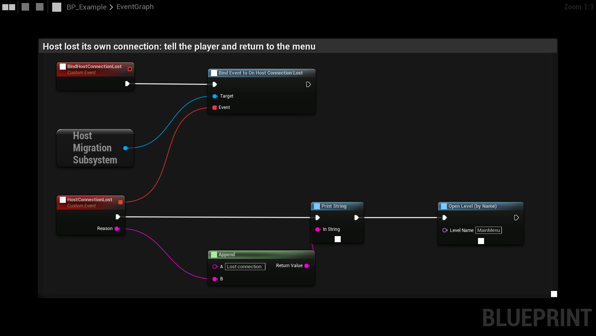

# Lost connection: rejoin, reconnect, split brain

A dropped connection does not always mean the host is gone. These rules keep one player's network trouble from
splitting the match. They need an adapter with presence and announcements (Steam and EOS do both).

## Is the host gone, or only us?

When the connection drops, the client asks the adapter whether the host is still in the session (Steam and EOS:
lobby membership).

- **The host is still there:** the client **rejoins the host** (state `RejoiningHost`) for up to **Rejoin Timeout**
  and gets its state back as a returning player. No migration, so a player with a hiccup never splits off into a match
  of their own.
- **The host leaves the session meanwhile:** the client migrates after all.
- **The host stays but cannot be reached:** the client gives up (**Migrate When Host Unreachable** off, the default)
  or migrates anyway (on).

## Connecting to the new host

Connections are retried **Max Reconnect Attempts** times, **Reconnect Retry Delay** apart. An attempt that has not
connected within **Connect Attempt Timeout** (30 s, 0 = no limit) is cancelled and counts as failed. If that host stays
unreachable, the client moves on to the next candidate. A candidate that does not announce itself within
**Candidate Timeout** is skipped.

## First announcement wins

Waiting clients join any host that announces the new epoch, not only the candidate they were waiting for. A candidate
whose turn comes while another host is already up joins that host instead of starting its own.

## Two hosts at once

This can happen when a slow successor comes up after the others gave up on it. Hosts watch each other's
announcements. A host that sees a better one on two checks in a row **yields** and moves its players there.

Better means, in order: higher epoch, more players, earlier in the election order. A host that went offline cannot update its announcement, so its old epoch keeps it from winning.

The winner restores the moved players as returning players. Progress made on the losing host is lost.

Two cases do not count as a competing host:

- **The old host's announcement.** A host that crashed, or quit without leaving the lobby, can stay listed with the
  address and epoch it had before the migration. An announcement from the lost host with a lower epoch than this
  host's is ignored.
- **A host this machine could not reach.** If the yielding host cannot connect to the winner within **Max Reconnect
  Attempts**, it hosts again with a higher epoch and its saved state, and ignores that host from then on. Its players
  join it again.

## The host loses its own connection

When the host's internet drops, the clients migrate without it, and the old host keeps playing alone. **On Host
Connection Lost** fires on that host when Steam reports it logged off, or when at least two clients all time out within
5 seconds. Use it to tell the player and return to the menu. Bind it in your GameInstance, as with the other
[subsystem events](../blueprint/blueprint-overview#subsystem-events).

## LAN / Null

The Null adapter has no presence and no announcements, so none of this applies: clients wait a fixed time for the
successor, and two hosts can still happen.
