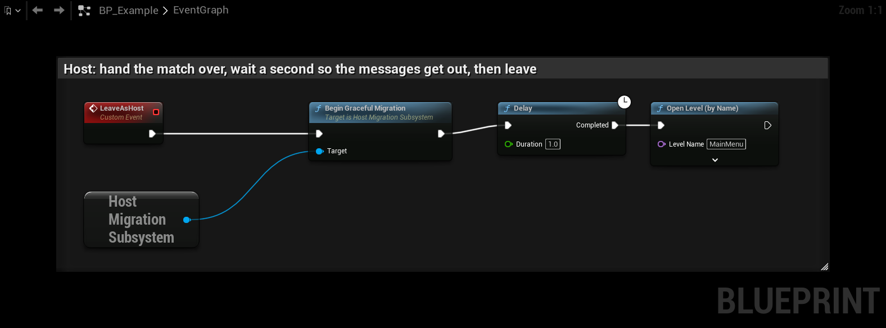

# Map changes and leaving

## ServerTravel

ServerTravel, seamless or not, works as usual. After the change, the new map's state streams to clients from scratch,
starting with a full snapshot.

- **During a map change** (from the host's travel until the new map is loaded), a lost connection does not start a
  migration, because the state is being replaced right then. If the host dies exactly then, Unreal's normal disconnect
  handling applies.
- **A client that cannot follow a non-seamless travel** while the host is still in the session rejoins the host on its
  new map (state `RejoiningHost`) instead of being dropped. This happens on EOS, where the host closes its P2P socket
  when it loads the new map. See [EOS](eos#map-changes).
- **A snapshot is only used on the map it was taken on.** Right after a seamless travel, before the first snapshot of
  the new map has arrived, losing the host is not migrated either.
- **Players who stepped away** keep their PlayerState data across map changes. Their pawn belonged to the old map, so
  they get a new one.
- Players moving with a seamless travel are not treated as leaving.
- Seamless travel keeps PlayerState data only through your PlayerState's `CopyProperties`, as usual in Unreal. See
  below.

### Keep PlayerState data through seamless travel

On a seamless travel, Unreal gives every connected player, the host included, a **new PlayerState** on the new map.
It then copies the old one over with `CopyProperties`. The base class copies only its own fields (name, score, unique
id and so on). **Any variable you added to your PlayerState is reset to its default** unless you copy it yourself.

This is standard Unreal behaviour, and the plugin does not change it. But it can look like a migration problem:

- **Players who stepped away** before the travel keep all their `SaveGame` PlayerState data. The plugin stores them
  and restores them when they come back.
- **Connected players** keep only what `CopyProperties` copies.
- **A migration after the travel** saves whatever the PlayerStates hold at that moment. It carries over values that
  were already reset.

So after a seamless travel, a player who left and came back can have more points than the players who stayed.

**C++:** override `CopyProperties` and copy every field you want to keep:

```cpp
// MyPlayerState.h
virtual void CopyProperties(APlayerState* PlayerState) override;

// MyPlayerState.cpp
void AMyPlayerState::CopyProperties(APlayerState* PlayerState)
{
	Super::CopyProperties(PlayerState);
	if (AMyPlayerState* NewPlayerState = Cast<AMyPlayerState>(PlayerState))
	{
		NewPlayerState->Points = Points;
	}
}
```

**Blueprint:** in your PlayerState Blueprint, implement the **Event Copy Properties** event. Cast its `New Player
State` to your class and set your variables on it.

A non-seamless travel reconnects everyone, so PlayerState data is not carried over at all there, with or without the
plugin. Keep data that must survive it somewhere else, such as the GameInstance or a save game.

## Leaving the match

Use **Leave Session** (with the map to go to) instead of a plain `open <map>`:

| Who | What happens |
|---|---|
| Host | Hands the match over (graceful migration) before travelling. The others play on. |
| Client | Just leaves. The host keeps the player's state for a rejoin. |

A host that leaves with a plain `open` ends the match for everyone, as it would without the plugin.

## Quitting the game

| How the host quits | What happens |
|---|---|
| Closes the window (X, Alt+F4) | Hands the match over, then closes about 1.5 s later. The window hides at once. Turn off with `bHandOverOnWindowClose`. |
| **Quit Game** node of the subsystem | Same: hands over, then quits. |
| The engine's **Quit Game** node or the `quit` command | Exits at once. The others treat it as a crash and migrate after the timeout, losing progress since the last snapshot. |

Use the subsystem's **Quit Game** for your quit button. Window-close handling works in packaged and standalone
games, not in PIE. If your game already handles the window close (e.g. an "are you sure?" prompt bound to
`OnWindowCloseRequested`), it is asked first.

**Begin Graceful Migration** is the lower-level version for the host: it sends a final snapshot and tells everyone to
migrate. Leave about a second later, so the messages get out.


