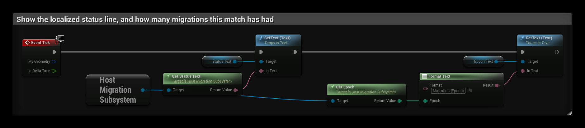
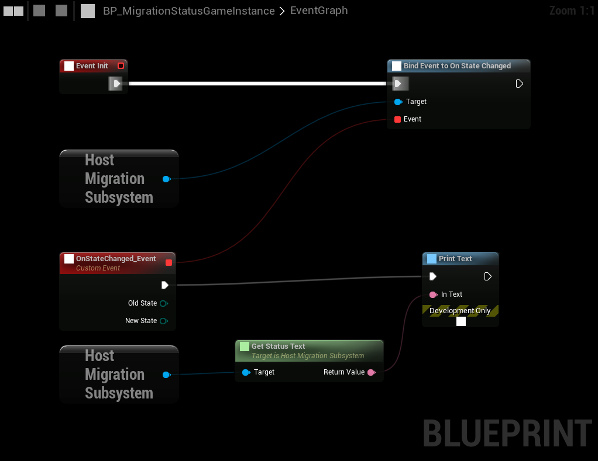
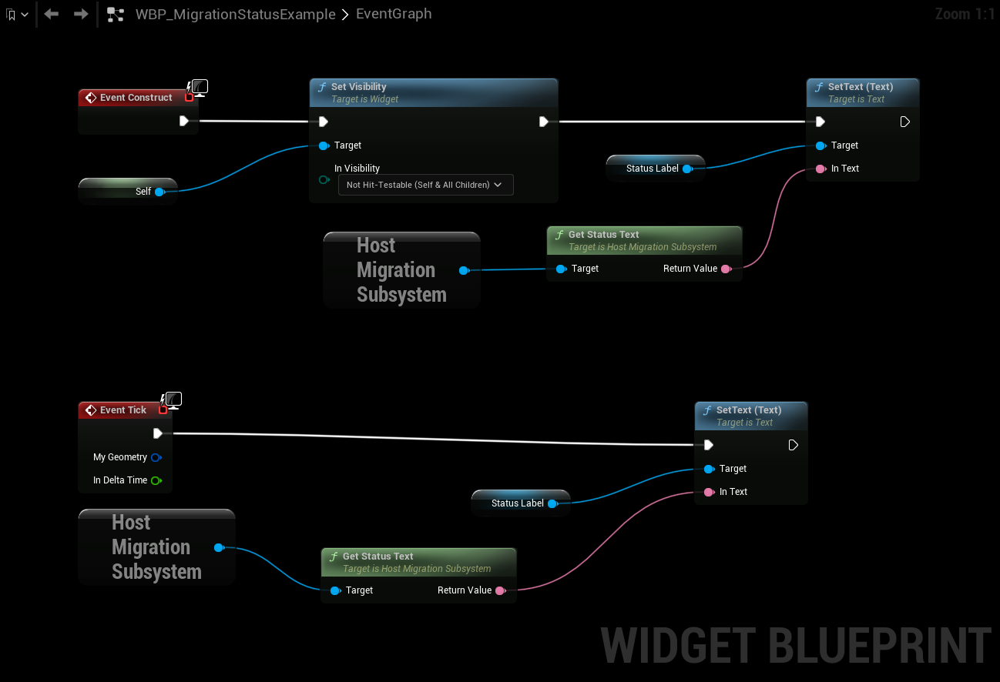

# Pause and overlay

## Pause

**Pause During Grace Period** (default on): the new host pauses the game while previous players reconnect, and
unpauses when the grace period ends, the migration fails or the host yields.

- Players cannot lift this pause.
- Pauses your game sets itself are not touched.
- If everyone is already back while the map loads, nothing is paused.

## Built-in overlay

**Show Migration Overlay** (default on): a dimmed "reconnecting" screen with the current status on every machine while
a migration runs. It lets input through and is added again after every map load. After a failed migration it shows
"Could not continue the match" for **Failed Overlay Seconds**.

## Your own overlay

Set **Overlay Widget Class** to any UMG widget. It is created and removed at the same times as the built-in one.

Bind its text to **Get Status Text** on the subsystem. It is localized, for example
"Waiting for players to return (2 left)". You can also use **Get State**, **Get Num Players Awaited** and
**On State Changed** for your own layout.

The widget is created again after every map load during a migration. Read the subsystem's state as above, and do not
keep your own state in the widget.

To handle everything yourself, turn **Show Migration Overlay** off and bind **On State Changed**.

## Blueprint example in HostMigrationTest

Open **HostMigrationDocs** in the Content Browser for two Event Graph examples:

- **BP_MigrationStatusGameInstance** assigns **On State Changed** in **Event Init**. The resulting custom
  event logs **Get Status Text** on each transition. The binding lives in the GameInstance across map changes.

  

- **WBP_MigrationStatusExample** sets its status label from **Get Status Text** in **Event Construct** and
  refreshes it in **Event Tick** while on screen. This keeps the text current when the number of players
  awaited changes within the same migration state. The widget passes mouse input through.

To use the widget, leave **Show Migration Overlay** enabled and set **Overlay Widget Class** to
**WBP_MigrationStatusExample**. The plugin adds the widget to the viewport and shows it again after map
travel when a migration is still in progress. The status always comes from the subsystem.

For the logging example in a test project, select **BP_MigrationStatusGameInstance** as the **Game Instance
Class** under **Project Settings > Maps & Modes**. If your game already has a custom GameInstance, copy the
event binding into its existing **Event Init** graph. The widget can be used on its own.

Test with [separate game processes](../getting_started/testing#local-null-adapter). During a host handover,
look for state messages and confirm the overlay appears again after travel while reconnecting and disappears
when play resumes.
