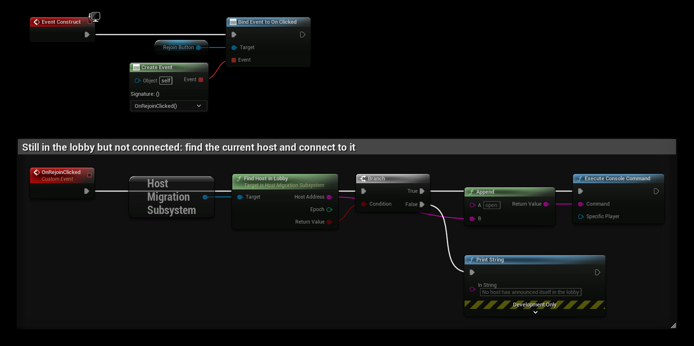

# Players who come back

When a player leaves, the host keeps their PlayerState data for **Inactive Player Timeout** seconds (default 300). The
same goes for a player who does not return within a migration's grace period, and for the host that was lost.

If they rejoin with the same unique net id, they get their state back, and their old pawn if it still exists and nobody
else controls it. These records travel in the snapshot, so they survive further migrations. **On Player Restored**
fires on the host when it happens.

## The pawn of a player who leaves

Unreal destroys the pawn of a player who leaves. **Leaving Player Pawn** decides what happens instead. The pawn needs a
Host Migration Id.

| Option | Behaviour |
|---|---|
| **Keep In World** (default) | The pawn stays, unpossessed, with the same id and state. The player takes it over again on rejoin. Destroyed when the record expires. |
| **Respawn On Rejoin** | The pawn disappears. Its state (with components) is kept in the player's record, also across migrations, and it is spawned again where it was when the player returns. |
| **Destroy** | Unreal's behaviour. The player gets their PlayerState back and a new pawn. |

**On Host Migration Restored** also fires on a kept or respawned pawn.

When a record expires, the player's unpossessed pawn is destroyed (**Destroy Pawn When Inactive Expires**).

## New players

Players who join after a migration join like any other player. Players who are not connected yet can find the current
host with **Find Host In Lobby**. See [Steam](steam) and [EOS](eos).

A Rejoin button for a player who is still in the lobby:

