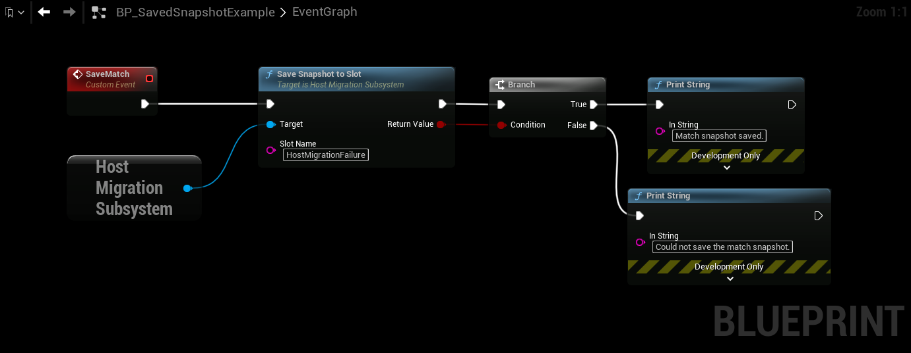
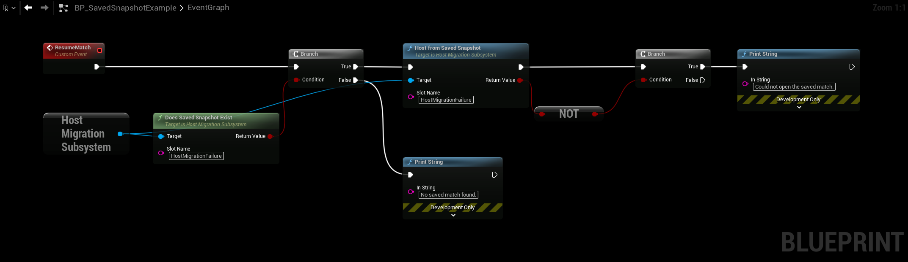

# Saved snapshots

Use a local snapshot slot to resume a match after a failed migration, or to save a match manually. Slots
use Unreal's local save storage and belong to the machine that wrote them.

In the HostMigrationTest project, open **HostMigrationDocs → BP_SavedSnapshotExample** in the Content Browser.
The **SaveMatch** and **ResumeMatch** custom events in **Event Graph** use the default failure slot,
**HostMigrationFailure**, and print success or failure to the development log. Call **SaveMatch**
from a match action and wire **ResumeMatch** to your menu button. Replace the print nodes with
your game's UI feedback.

## Save a snapshot

Call **Save Snapshot To Slot** on the Host Migration subsystem with a slot name.

- A listen host captures the current match.
- A client writes its last valid snapshot. It may be older than the state the player last saw.
- The node returns false if there is no usable snapshot to save or the write fails.

To save automatically on failure, enable **Save Snapshot On Failure**. When there is a valid snapshot
available, the plugin writes it to **Failure Snapshot Slot**. The default slot name is
`HostMigrationFailure`.

## Add a Resume Match button

1. In your menu, call **Does Saved Snapshot Exist** with your slot name to decide when to enable
   **Resume Match**.
2. When clicked, call **Host From Saved Snapshot** with that same slot name. On success, the subsystem
   starts loading the saved map as a listen server and restores the match. If it returns false, show an
   error and keep the menu open. A slot can exist but contain an unreadable or incompatible snapshot.
3. Reconnect other players through your game's normal lobby or join flow. The resume node starts
   hosting locally. Set up any lobby membership your backend requires.
4. To let the player clear the saved match, add a separate action that calls **Delete Saved Snapshot**.

A snapshot references the saved map and game classes and uses a versioned plugin format. Keep those
assets available in the packaged build and verify that snapshots still load after an update before
relying on them across releases.
