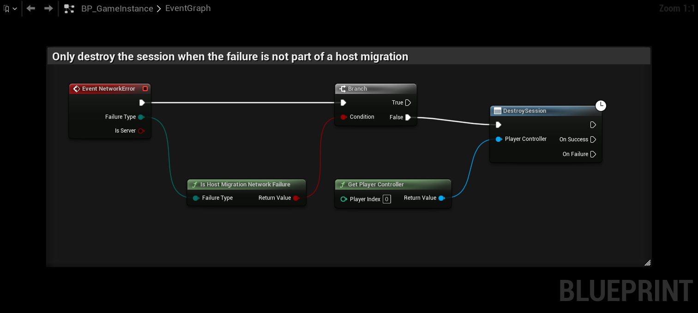

# Session plugins

Many session plugins and GameInstances bind `GEngine->OnNetworkFailure` and destroy the session when the connection to
the host is lost. During a host migration that breaks the match:

- With Steam and EOS, destroying the session also leaves the lobby. The adapter needs the lobby to announce the new
  host and to find it, so a client that left cannot see the new host. When it times out, it becomes a second host.
- When every member has left, Steam and EOS delete the lobby. Nobody can find the match again, not even the old host.

So a session plugin must not destroy the session or leave the lobby while a migration runs.

## Check the failure first

**Is Host Migration Network Failure** returns true when a network failure starts a host migration or belongs to one:
the host left or crashed, or a migration is already running. It does not depend on whether your handler runs before or
after the plugin's own handler.

In C++, call it first in the handler that destroys the session:

```cpp
#include "HostMigrationBlueprintLibrary.h"

void UMyGameInstance::HandleNetworkFailure(UWorld* World, UNetDriver* NetDriver, ENetworkFailure::Type FailureType, const FString& Error)
{
	if (UHostMigrationBlueprintLibrary::IsHostMigrationNetworkFailure(this, FailureType))
	{
		return;
	}
	DestroyGameSession();
}
```

In Blueprint, use it in the GameInstance's **Event Network Error** before the node that destroys the session or leaves
the lobby. Only continue on **False**.



**Is Host Migration In Progress** is true for the whole migration. Use it for session code that runs later, for example
a timer that checks whether the player is still in a session.

If the session plugin is not your own code, override its failure handler in your GameInstance, or turn the behaviour
off in its settings if it has one.

To leave the match on purpose, use **Leave Session** or **Quit Game** on the Host Migration subsystem. On the host
they hand the match over first. On a client, **Leave Session** marks the leave as a map change, so the network failure
that follows is not a migration failure. Destroying the session afterwards is safe in both cases.

## Example: Advanced Multiplayer Sessions

Advanced Multiplayer Sessions (AMS) destroys the GameSession on every network failure in its GameInstance. With Steam,
that leaves the lobby on every client as soon as the host hands the match over. Override the failure handler in your
GameInstance, and skip the session destroy when **Is Host Migration Network Failure** is true.

## What the adapters do

The Steam and EOS adapters have two fallbacks for a player who left the lobby during a migration.

**Rejoining the lobby.** The adapters remember the lobby. If the local player is no longer in it, they join it again
by its id and announce the new host once they are back. This only works while the lobby still exists, so at least one
member must still be in it. On EOS the lobby also needs **Allow Join By Id**.

The same happens during the match: a short internet drop can remove a player from the lobby while the game connection
recovers. After 5 seconds outside the lobby the adapter joins it again, so the player can still find or announce the
host at the next migration.

Leaving the lobby on purpose is different. On EOS, if the lobby came from your `GameSession` and you destroy that
session, the adapter does not join the lobby again. On Steam it can't tell the two apart, so if your game leaves the
lobby but stays in the match for more than 5 seconds, the adapter joins it again. Leave the match first, or enter the
next lobby within those 5 seconds.

**Connecting to the successor directly.** Every client knows from the snapshot which player should become the new
host, and the adapter can work out that player's address without the lobby (`steam.<SteamID64>` on Steam,
`EOS:<ProductUserId>:...` on EOS). If a client waiting for the new host is not in the lobby when
**Candidate Timeout** runs out, it connects to the successor directly instead of hosting itself. Only if that fails
does it move on to the next candidate. This works even when the lobby is already gone.

Both are fallbacks. They cost a few seconds, and they only bring the players back together. Once the lobby is gone,
**Find Sessions** and **Join Session** cannot find the match anymore, so players who come back or join late cannot
join it. Keep the session alive instead.
