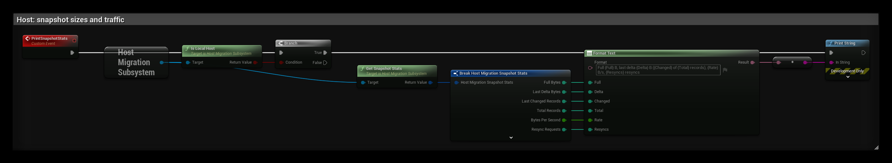

# Snapshot traffic

Snapshots are compressed and sent in chunks over reliable RPCs.

## Delta snapshots

Each snapshot gets a sequence number. A client that has the previous one only gets a **delta**: the records (an actor,
a player, the globals) that changed, plus removals. New clients get a full snapshot. An unchanged world sends nothing.

Every delta carries a hash of the complete state. If a client's rebuilt snapshot does not match, or a delta does not
follow the snapshot it has, the client asks the host for a full snapshot. This happens by itself.

Measured with 4 players, 300 static props and gameplay going on:

| | Size |
|---|---|
| Full snapshot | 27 KB |
| Delta | about 0.9 KB |
| Host traffic with deltas | about 4 KB/s |
| Host traffic without deltas | about 40 KB/s |

## Tuning

- **Snapshot Interval:** lower means less progress lost on a crash, but more traffic.
- **Use Delta Snapshots:** turn off to always send full snapshots.
- **Chunk Size:** compressed bytes per RPC.
- **Get Snapshot Stats** (host) returns the size of the last full snapshot, last delta size, changed records, bytes per second and counts of
  fulls, deltas and resyncs. A summary is logged every 30 s.
- Only mark what must survive as SaveGame. Large records that change often (big inventories) are resent whole every
  time they change.

## Size limit

A full snapshot larger than **Max Snapshot Bytes** (compressed, default 512 KB) is not sent.

- Clients that already have a snapshot keep getting deltas.
- New clients get nothing, so they cannot take part in a migration.
- The host logs an error once and fires **On Snapshot Too Large** (Snapshot Bytes, Max Snapshot Bytes) when the size
  crosses the limit. **Get Snapshot Stats** reports it as **Over Size Limit**, and the
  [debug overlay](../getting_started/testing#debug-overlay) shows it in red.

Clients ignore anything above twice **Max Snapshot Bytes** compressed (or 32 times that uncompressed), and the host
does not send deltas that large.

Clients apply deltas in place and only hash the records that changed, so a small delta stays cheap on a large
snapshot.

## Testing resyncs

`HostMigration.Debug.DropEveryNthDelta N` on a client drops every Nth delta, to see the resync at work.
