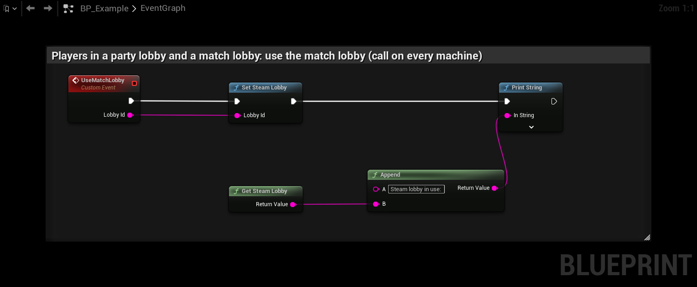

# Steam

## Setup

1. Set **Adapter Class** to **Steam Adapter**.
2. Use a Steam net driver whose addresses are `steam.<SteamID64>`: **SteamSockets** (engine) or
   **SteamCoreSockets** (SteamCore PRO).
3. Keep every player in a **Steam lobby** for the whole match. The lobby outlives the host, so it is what the players
   use to find each other again.
4. Something must initialise Steam and pump its callbacks: OnlineSubsystemSteam, SteamCore PRO, or your own code.

The adapter never loads or initialises Steam itself. It waits until your Steam layer has loaded the Steam API and then
uses that same copy, so it works next to OnlineSubsystemSteam, SteamCore PRO or raw Steamworks without a second Steam
loader in the game.

### With SteamCore PRO

Disable OnlineSubsystemSteam and SteamSockets and use SteamCore PRO's own subsystem and net driver:

```ini
[/Script/Engine.GameEngine]
!NetDriverDefinitions=ClearArray
+NetDriverDefinitions=(DefName="GameNetDriver",DriverClassName="/Script/SteamCoreSockets.SteamCoreSocketsNetDriver",DriverClassNameFallback="/Script/SteamCoreSockets.SteamCoreSocketsNetDriver")
```

Create or join the lobby with SteamCore PRO as usual. The adapter detects it.

## The lobby

The adapter detects the lobby by itself. It listens for Steam's `LobbyEnter_t`, which fires whenever the local user
enters a lobby, whichever API joined it: OnlineSubsystemSteam, SteamCorePRO, Advanced Steam Sessions or raw Steamworks.
The most recently entered lobby is used.

If players are in more than one lobby (a party lobby and a match lobby), call **Set Steam Lobby** with the match
lobby's id on every machine. **Get Steam Lobby** returns the lobby in use.



**Entering another lobby** counts as leaving the match. When the adapter switches to a lobby it detected, nothing from
the old match is announced there, and a host with players hands the old match over first, as with **Begin Graceful
Migration**. **Set Steam Lobby** does not do this. If your game moves a running match to a new lobby, call it with the
new lobby's id.

**Dropping out of the lobby during a match:** the adapter joins the lobby again after 5 seconds, then retries every 10
seconds while Steam is logged on. A lobby the player left outside a match is forgotten, so it is not joined again by a
later match. A lobby set with **Set Steam Lobby** is kept until you change it.

**After Move Party To Host**, the players are connected to the new host but still members of the old lobby. The
plugin moves the connections, not the lobby membership. If the new host then goes down, the players look for the next
host in the old lobby and don't find it. Have every player join the new host's lobby once they have arrived, or call
**Set Steam Lobby** with its id. They are clients of the new host by then, so entering that lobby does not hand anything over.

Don't destroy the session or leave the lobby while a migration runs. If your session plugin does, see
[Session plugins](session-plugins).

## Join Session works after a migration

The engine's **Join Session** node (and Advanced Sessions) connects to the address stored in the lobby when it was
created, which is the original host. The adapter keeps that address current: whoever owns the lobby hands ownership to
the current host, and the host then points the lobby's session address (`P2PADDR`, `OWNINGID`, `OWNINGNAME`) at
itself. This takes a second or two after a migration. Only keys that already exist are changed, so lobbies created
another way are left alone.

So players coming back, or joining late, can use the usual **Find Sessions** and **Join Session** nodes.

## What the adapter does

| Question | Answer from Steam |
|---|---|
| Is a player still in the session? | Lobby membership. |
| Where is the host? | The host's own lobby member data: `hm_addr`, `hm_epoch`, `hm_players`. |
| Is the host still running? | `hm_beat`, updated every 5 s while hosting. |
| Is the successor still loading? | `hm_loading`, set while the successor loads the map. |
| What is my address? | `steam.<my SteamID64>`. |

Member data of a player who left disappears with them, so only live hosts are listed.

## After a migration

**On Host Changed** fires on every machine with the new host's id and address. On the new host, use it to update
things that point at the old host: lobby data your matchmaking reads, rich presence connect strings, or a session you
advertise.

Players who are not connected yet (late joiners, returning players) can use **Join Session** (see above), or call
**Find Host In Lobby** to get the current host's address. If several members have announced, the one with the highest epoch wins, then the most players.

## Crash timing

After a host crash, clients first try to rejoin it while Steam still lists it in the lobby. The migration starts when
Steam removes the crashed host from the lobby, or when its `hm_beat` has not changed for 15 seconds, whichever comes
first. A crash still takes longer than a graceful leave.
