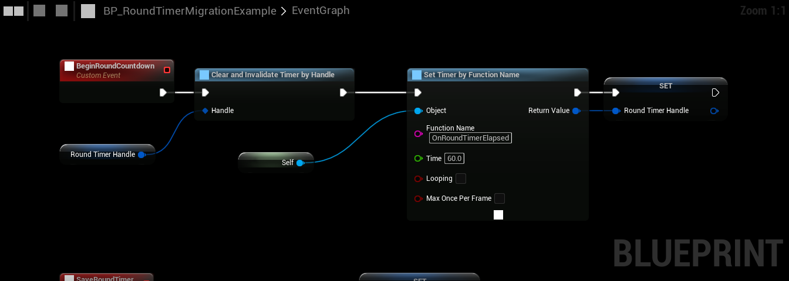
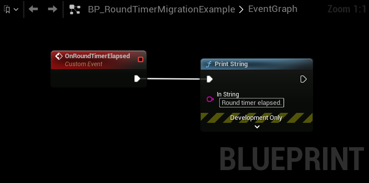
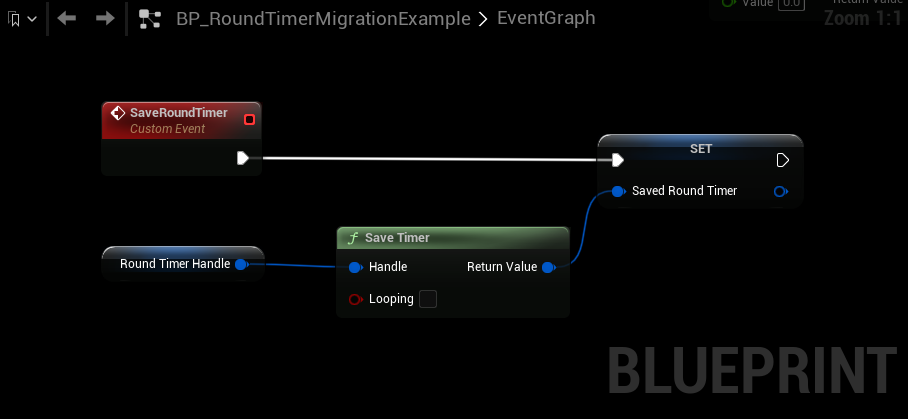
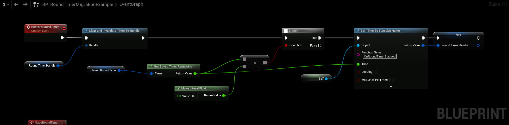

# What gets saved

## Which objects

| Object | Needs a Host Migration Id? |
|---|---|
| Placed actors | Yes |
| Actors spawned at runtime | Yes. They are spawned again on the new host. |
| Player pawns | Yes |
| PlayerStates | No. Matched to the returning player by unique net id. |
| GameState, GameMode | No |
| Components | No. Saved with their owner. |

A placed actor that was destroyed before the migration stays destroyed on the new host.

Each Host Migration Id must belong to one actor. If two actors carry the same id, the log warns *Host Migration Id ... is used by both ... and ...; only the last one is
saved*.

### Level streaming and World Partition

Placed actors in streamed levels and World Partition cells are restored too:

- **Levels the new host has not loaded yet:** the saved state of their placed actors (and which ones were destroyed)
  is applied when the level is added. Until then the new host keeps that state in its own snapshots, so it survives
  another migration.
- **Levels that were unloaded on the old host** when the snapshot was taken have no saved state. Their placed actors
  come back as they are placed in the level.

## Which data

- **SaveGame variables.** Tick **SaveGame** on Blueprint variables (Advanced section), or use `UPROPERTY(SaveGame)` in
  C++. Structs, arrays, maps and object references are supported. For structs, see [below](#structs).
- **Custom data (C++).** Implement [`IHostMigratable`](../cpp/host-migratable) for anything SaveGame cannot express.
- The actor's transform is always saved.
- A restored or respawned actor already has its saved Host Migration Id in **BeginPlay**.

## Owner, Instigator and attachments

- **Owner and Instigator** are restored when they point at a migrated actor. An owner that is a player's
  PlayerController is set again once that player is connected: right away for the new host's own player, and on
  reconnect for players who return during the grace period.
- **Attachments:** an actor attached to a migrated actor is attached again, to the same component (matched by name)
  and socket.

## AI controllers

A pawn that had an AI controller gets one again on the new host.

- **The controller has a Host Migration Id:** it is migrated like any other actor and possesses the pawn again, so
  its SaveGame variables come along.
- **No id:** a new controller of the same class is spawned. Its blackboard, behavior tree progress and other state
  start fresh. A pawn that already got a controller on spawn (**Auto Possess AI**) keeps that one.

## Match state

With a GameMode based on `AGameMode` (not `AGameModeBase`), a match that was in progress is started again on the new
host, and a match that had ended is ended again. Custom match states are not restored.

## World time

The new host's world clock starts from zero, so a **Get Game Time in Seconds** value saved on the old host means
nothing on the new one. Convert it with **To Restored World Time** on the subsystem. **Get Migrated World Time
Offset** returns the difference. Both are set before **On Host Migration Restored** runs.

## Movement and physics

**Save Motion** on the **Host Migration Id** component is enabled by default.

| Actor | Motion carried over |
|---|---|
| `ACharacter` with a Character Movement component | Velocity, movement mode, and custom movement mode. |
| Other actors with a physics-simulating primitive root component | Linear and angular velocity. The root must also be simulating physics when the velocity is restored. |

For a custom movement component or a separate physics body, capture the state you need in
**On Host Migration Save** and apply it in **On Host Migration Restored**.

## Components

Every component with SaveGame variables (or `IHostMigratable`) is saved with its owner: default components,
components added in the Blueprint editor and components added at runtime. This works on actors, PlayerStates, the
GameState and the GameMode alike, so an inventory component on the PlayerState just works.

Components are matched by name. A component that was added at runtime and is missing on the new host is created again
with the same name and class.

## Structs

:::warning Every struct member needs SaveGame too
Marking a struct variable (or an array of structs) as SaveGame is not enough. Inside the struct, only members that are
**also** marked SaveGame are saved; the others come back with their default values. This applies at every level, also
to structs inside structs.
:::

- **Blueprint structs:** open the struct and tick **SaveGame** on each member that should carry over.
- **C++ structs:** add `SaveGame` to each member's `UPROPERTY`.

Example: an inventory component with a SaveGame array of items.

```cpp
USTRUCT(BlueprintType)
struct FInventoryItem
{
	GENERATED_BODY()

	UPROPERTY(SaveGame, BlueprintReadWrite)
	FName ItemId;              // saved

	UPROPERTY(SaveGame, BlueprintReadWrite)
	int32 Count = 0;           // saved

	UPROPERTY(BlueprintReadWrite)
	int32 Durability = 0;      // NOT saved: 0 after a migration
};

UCLASS()
class UInventoryComponent : public UActorComponent
{
	GENERATED_BODY()

	UPROPERTY(SaveGame)
	TArray<FInventoryItem> Items;
};
```

After a migration `Items` has the same entries with the same `ItemId` and `Count`, and `Durability` is 0.

### Items as UObjects

Items created as objects (`NewObject<UInventoryItem>(this)`, or Blueprint "Construct Object") are not saved: a
reference to them points at an object that does not exist on the new host, so it is null after the migration. Use
structs for item data, or in C++ save the items yourself with [`IHostMigratable`](../cpp/host-migratable).

## References

Object references are stored so they still point at the right thing after the migration:

| Reference to | Stored as | After the migration |
|---|---|---|
| An actor with a Host Migration Id, or one of its components | Migration id | Points at the same actor, even if it was spawned again. |
| A PlayerState | Unique net id | Resolves if that player is connected when the object is loaded. Otherwise null. |
| Assets, classes, placed actors without an id | Path | As before. |

Raw pointers, `TObjectPtr`, `TWeakObjectPtr` and references written through `IHostMigratable` all work.

## What is not saved

- Variables without the SaveGame flag, including struct members without it.
- Objects created at runtime that are not actors or components (`NewObject`, "Construct Object").
- Actors without a Host Migration Id.
- Owners that are neither migrated actors nor a player's PlayerController (for example a PlayerState), and owners
  whose player does not return during the grace period.
- The state of AI controllers without a Host Migration Id.
- Timers, animation state, and in-flight RPCs. See [Movement and physics](#movement-and-physics) for the supported velocity data. Save what you need in
  [On Host Migration Save](../blueprint/events) and restart it in **On Host Migration Restored**.
- Progress made after the last snapshot (at most one Snapshot Interval). A graceful leave sends a final snapshot.

## Restoring timers

In the HostMigrationTest project, open **HostMigrationDocs → BP_RoundTimerMigrationExample** in the
Content Browser. In **Event Graph**, the custom event **BeginRoundCountdown** clears the previous timer and starts a
new 60-second countdown. **Set Timer by Function Name** uses **OnRoundTimerElapsed** as the callback,
and its return value is stored in **Round Timer Handle**.



When the countdown ends, the **OnRoundTimerElapsed** custom event prints a message. Replace this
debug output with your round-end logic.



The **SaveRoundTimer** custom event captures the one-shot timer and stores the result in
**Saved Round Timer**.



The **RestoreRoundTimer** custom event clears the existing timer and starts it again if the saved
remaining time is positive.



To wire these custom events into migration, add **Host Migration Id** and implement **Host Migration
Events** on the actor. Mark **Saved Round Timer** as **SaveGame**, call **SaveRoundTimer** from
**On Host Migration Save**, and call **RestoreRoundTimer** from **On Host Migration Restored**.

To resume a one-shot round timer in Blueprint, keep its timer handle when you start it. Add a variable
of type **Host Migration Saved Timer** to the migrated actor or component and mark it **SaveGame**.

1. In **On Host Migration Save**, call **Save Timer** with the handle and **Looping** off. Assign the
   result to the SaveGame variable.
2. In **On Host Migration Restored**, clear any timer that match initialization started for the same
   event. If **Is Saved Timer Active** is true and **Get Saved Timer Remaining** is positive, call
   **Set Timer by Event** with the saved remaining time and **Looping** off. Bind the original round
   timer event and store the new timer handle.
3. For a repeating timer, use the saved remaining time for the first firing and the saved **Rate**
   for subsequent firings. In Blueprint, a one-shot timer can run the first firing and start the
   repeating timer at that point.

In C++, call `UHostMigrationBlueprintLibrary::RestoreTimer` with the saved struct and a delegate bound
to the restored object. It returns a new `FTimerHandle`. Elapsed time while the match is migrating is
excluded from the saved countdown.