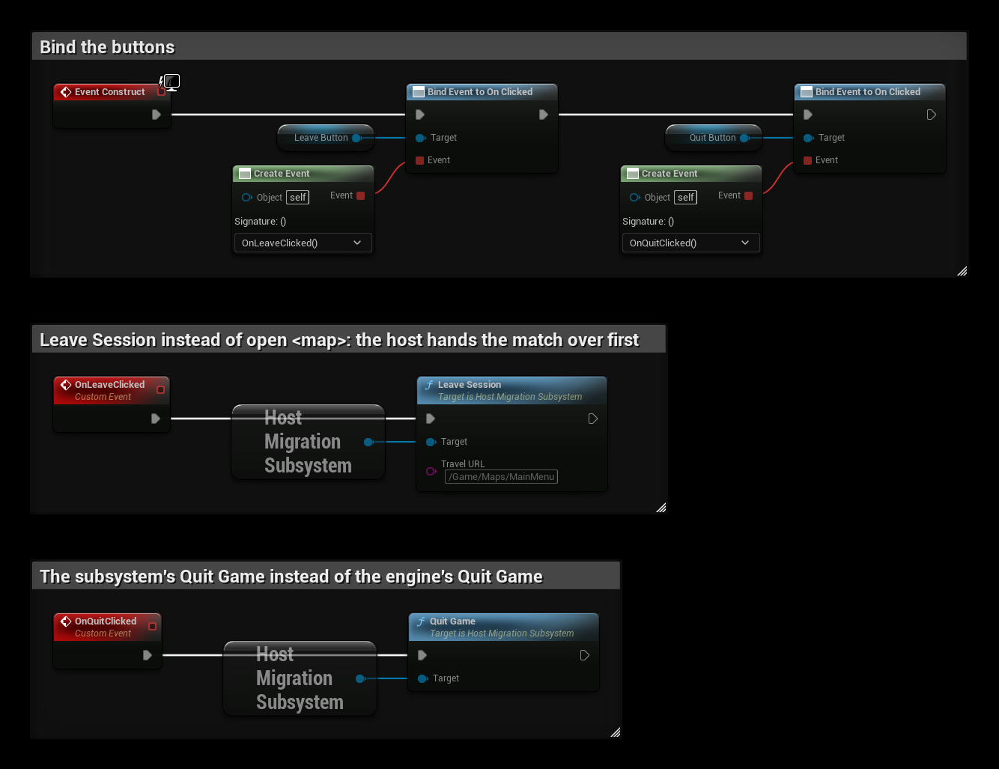

# Quick Start

## 1. Pick the adapter

**Project Settings → Plugins → Host Migration → Adapter Class**

- **Steam Lobby** for Steam. See [Steam](../features/steam).
- **EOS Lobby** for Epic Online Services. See [EOS](../features/eos).
- **Null** for LAN and local testing.
- Your own Blueprint or C++ adapter for anything else.

Or in `Config/DefaultGame.ini`:

```ini
[/Script/HostMigrationCore.HostMigrationSettings]
AdapterClass=/Script/HostMigrationCoreSteam.HostMigrationAdapter_Steam
```

## 2. Set a wait map

Create an empty map and set it as **Client Wait Map**. Clients load it while the new host starts up. Without it they
wait in the game's default map, usually the main menu.

## 3. Mark actors that should survive

Add the **Host Migration Id** component to every actor that should be carried over, including the player pawn.
PlayerStates, the GameState and the GameMode are always carried over and don't need it.

## 4. Mark the state to carry over

Tick **SaveGame** on each variable that should survive (variable details → Advanced → **SaveGame**). In C++:

```cpp
UPROPERTY(SaveGame)
int32 Score = 0;
```

Components with SaveGame variables are saved with their actor.

## 5. Let the host leave properly

When the host leaves on purpose, call **Leave Session** instead of `open <map>`, and the subsystem's **Quit Game**
instead of the engine's Quit Game. The match continues on another player's machine. Closing the game window is
handled for you.



That's it. Crash the host (or close it) and the match continues on one of the other players.

## Next steps

- [How it works](how-it-works): what happens during a migration.
- [Events](../blueprint/events): restart timers and effects after a migration.
- [Plugin Settings](plugin-settings): timings, pause, overlay.
- [Testing](testing): try it locally.
- [Example Project](example-project): a working Steam setup to download and try.
