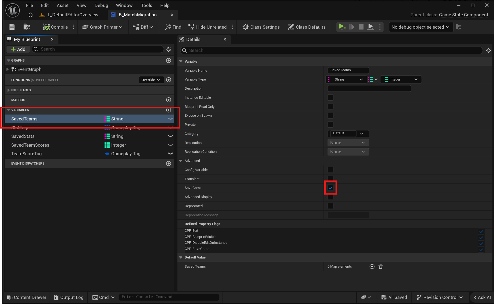
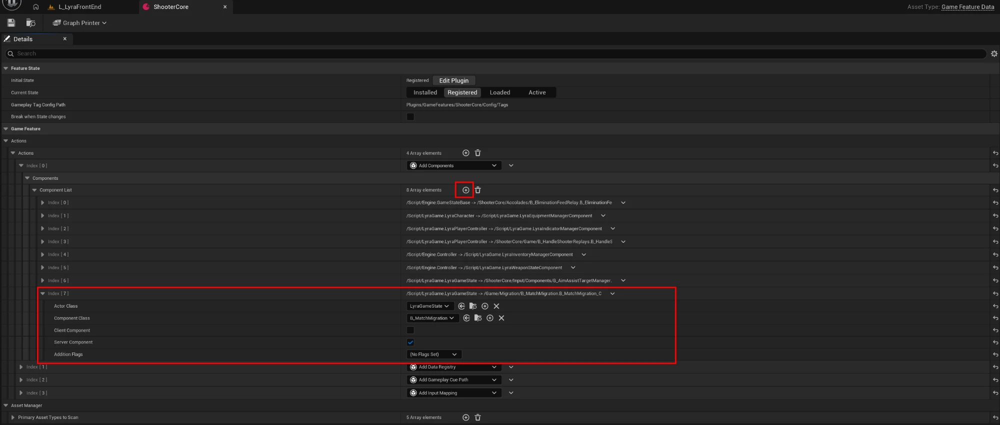
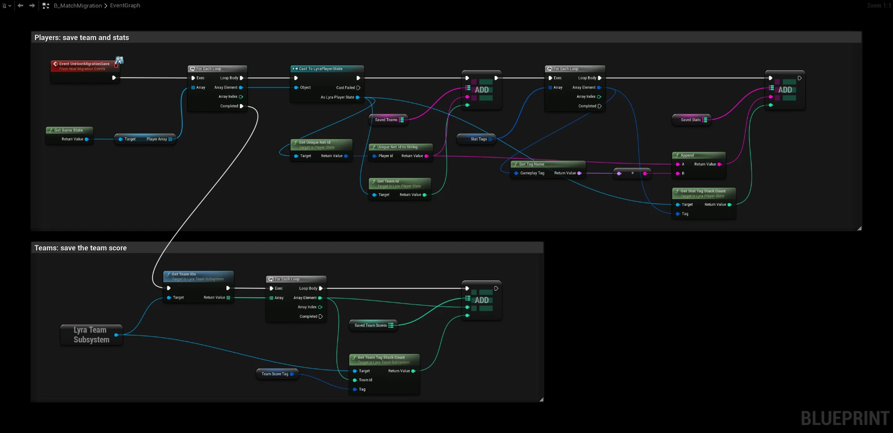
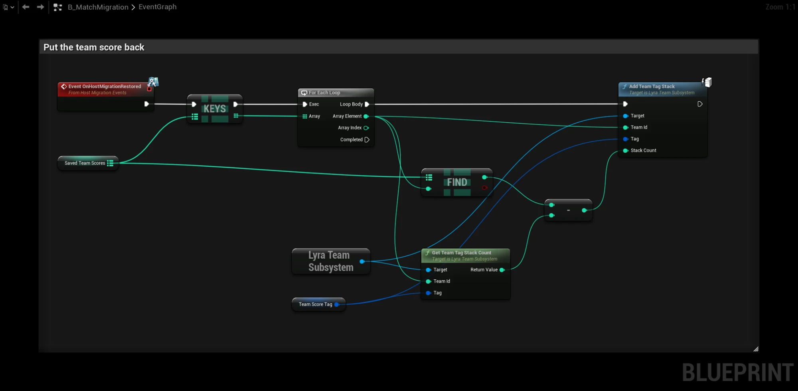
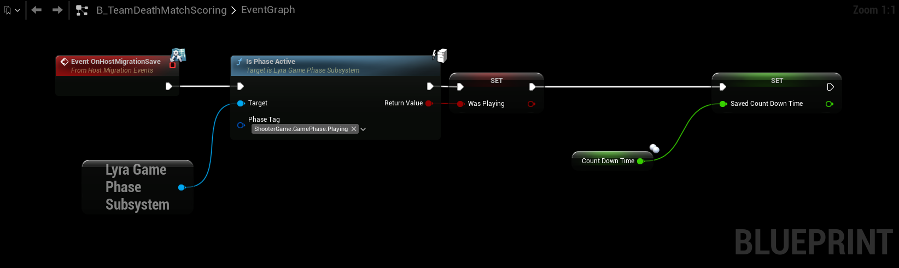
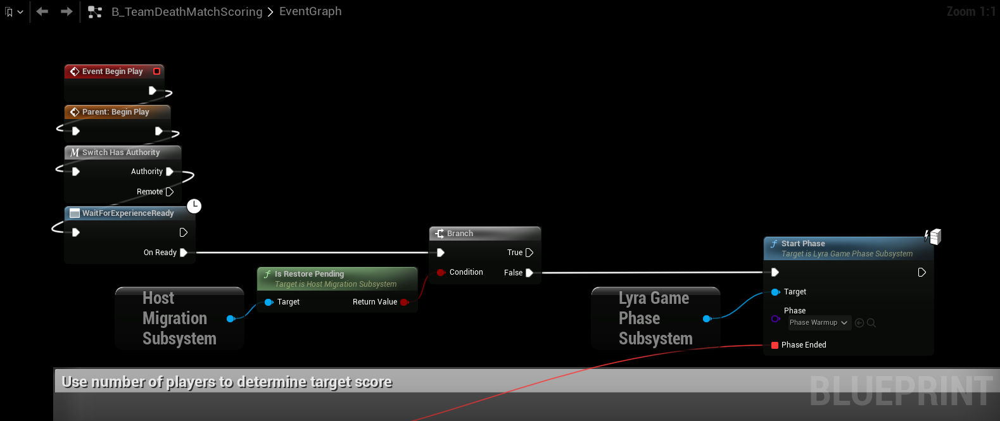
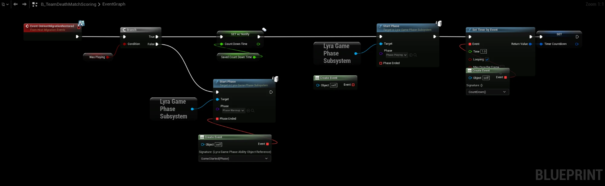

# Lyra Sample Project

After [Games that set up the match later](../features/game-ready), a Lyra match survives a host migration: the map,
the pawns and the players come back. The match itself still starts over: teams are picked again, kills, deaths and
the team score are back at 0, and the warmup and the timer start again.

Lyra keeps all of that in C++ properties without **SaveGame**, so the plugin does not save it. In this tutorial you
copy it into SaveGame variables of a small component, and put it back on the new host. Everything except one line is
Blueprint.

You need:

- [Wait For Game Ready](../features/game-ready#example-lyra) set up in Lyra.
- **Restore Into Game Pawn** on, so returning players keep the pawn Lyra spawns for them.

## What gets saved

| What | Where Lyra keeps it | Read with | Put back with |
|---|---|---|---|
| A player's team | Lyra Player State | **Get Team Id** | **Change Team For Actor** |
| Kills, deaths, assists | Lyra Player State, stat tags | **Get Stat Tag Stack Count** | **Add Stat Tag Stack** |
| Team score | Team info actor, team tags | **Get Team Tag Stack Count** | **Add Team Tag Stack** |
| Match phase and timer | `B_TeamDeathMatchScoring` | **Is Phase Active**, `CountDownTime` | **Start Phase**, **Set Timer by Event** |

The component writes these into maps on the host before every snapshot. The maps are SaveGame, so they travel with the
GameState to the new host.

## Step 1: one line of C++

**Change Team For Actor** is not available in Blueprint. In `Source/LyraGame/Teams/LyraTeamSubsystem.h`, add a
`UFUNCTION` line above it and build the project:

```cpp
UFUNCTION(BlueprintCallable, BlueprintAuthorityOnly, Category=Teams)
UE_API bool ChangeTeamForActor(AActor* ActorToChange, int32 NewTeamId);
```

## Step 2: the component

1. Create a Blueprint class with parent **Game State Component** and call it `B_MatchMigration`.
2. In **Class Settings → Interfaces**, add **Host Migration Events**.
3. Add these variables:

| Variable | Type | SaveGame | Default |
|---|---|---|---|
| `SavedTeams` | Map: String → Integer | yes | |
| `SavedStats` | Map: String → Integer | yes | |
| `SavedTeamScores` | Map: Integer → Integer | yes | |
| `StatTags` | Array of Gameplay Tag | no | `ShooterGame.Score.Eliminations`, `ShooterGame.Score.Deaths`, `ShooterGame.Score.Assists` |
| `TeamScoreTag` | Gameplay Tag | no | `ShooterGame.Score.Eliminations` |

**SaveGame** is under **Advanced** in the variable's details. Only the three maps need it.



`SavedTeams` uses the player's id as key. `SavedStats` uses the player's id plus the tag name, for example
`hulken-1234ShooterGame.Score.Deaths`, so all stats of all players fit in one map.

4. Open the **ShooterCore** Game Feature Data and find the **Add Components** action under **Actions**. Add an
   element to its **Component List**: **Actor Class** `LyraGameState`, **Component Class** `B_MatchMigration`,
   **Client Component** off, **Server Component** on.



Every ShooterCore experience now gets the component, Elimination as well as Control Point.

## Step 3: save on the host

**On Host Migration Save** runs on the host right before each snapshot.

- For every player in the GameState's **Player Array**:
  - Write the team into `SavedTeams`.
  - For every tag in `StatTags`, write the count into `SavedStats`.
- Then, for every team, write the team score into `SavedTeamScores`.



Bots have no player id, so they all write to the same empty entry. That does no harm: only players come back through
**On Player Restored**, so bots start with new stats on the new host.

The maps are never cleared. A player who left keeps their entry, so they get their stats back when they join again,
even after another migration.

## Step 4: put the team score back

**On Host Migration Restored** runs on the new host after the GameState and its components are restored. Lyra has
already created the teams at this point.

- For every team in `SavedTeamScores`, add the saved score minus the current score.

Adding the difference instead of the saved value means it does not matter whether the team already had points.



## Step 5: put each player back

Players come back one by one: the new host first, then the others as they reconnect. **On Player Restored** on the
Host Migration subsystem fires for each of them.

- On **BeginPlay**, bind **On Player Restored** to a `RestorePlayer` event.
- In `RestorePlayer`:
  - Find the player's id in `SavedTeams`. If it is there, **Change Team For Actor** puts them back in their team.
    This also overrides the team Lyra picked for them when they logged in.
  - For every tag in `StatTags`, add the saved count minus the current count.


## Step 6: keep the phase and the timer

The match timer is in `B_TeamDeathMatchScoring`. On **BeginPlay** it starts **Phase_Warmup**. When the warmup ends,
`GameStarted` sets `TargetScore` and `CountDownTime`, and starts a looping **Set Timer by Event** that counts down
every second. Without changes, the new host runs all of this again: a new warmup and a full timer.

1. Open `B_TeamDeathMatchScoring` and add the **Host Migration Events** interface in **Class Settings**.
2. Add these variables, and mark `TargetScore` as **SaveGame** too:

| Variable | Type | SaveGame |
|---|---|---|
| `WasPlaying` | Boolean | yes |
| `SavedCountDownTime` | Same type as `CountDownTime` | yes |

3. **On Host Migration Save:** set `WasPlaying` to **Is Phase Active** with the tag `ShooterGame.GamePhase.Playing`,
   and set `SavedCountDownTime` to `CountDownTime`.



4. **BeginPlay:** after **On Ready** (Wait For Experience Ready), add a **Branch** on **Is Restore Pending**. Connect
   **False** to **Start Phase (Phase_Warmup)**. Leave **True** empty, so the new host starts no warmup.


5. **On Host Migration Restored:** add a **Branch** on `WasPlaying`.
   - **True:**
     1. Set `CountDownTime` to `SavedCountDownTime`.
     2. **Start Phase** with **Phase_Playing**. Leave its **Phase Ended** pin empty.
     3. Start the countdown again. Copy **Set Timer by Event**, its **Create Event (CountDown)** and **SET Timer
        Countdown** from the end of `GameStarted`, and paste them after **Start Phase**.
   - **False:** the match was still in warmup. Do the same **Start Phase (Phase_Warmup)** as BeginPlay, with **Phase
     Ended** bound to `GameStarted`.



Don't connect `GameStarted` to **Phase Ended** of **Phase_Playing**. That pin fires when the playing phase ends, and
`GameStarted` would then move all players back to spawn and start a new countdown.

The timer continues from the last snapshot, so it can be up to one **Snapshot Interval** behind.

## Test it

1. Start an Elimination match with two players. Wait until the warmup is over and get a few kills.
2. Close the host. On the new host there is no warmup, the timer continues where it was, and the scoreboard shows the
   same teams, kills, deaths and team score.
3. Join again with the old host. They are back in their old team with their old stats.
